# Database Design (ADS presentation item 1: ERD, tables and relationships, primary and foreign keys)

**This page has three authors.** The diagram and the two tables below it are generated: re-take them with
`php storage/app/scratch/lane162-generate-erd.php --out=Documentation/DATABASE-DESIGN-ADS.md`, which reads
`information_schema` on the schema `.env` names — edges come from `KEY_COLUMN_USAGE`, an edge is drawn one-to-one
only when the referencing column set is actually UNIQUE, and the domain/framework split is derived from the bundled
`0001_` migrations plus `migrations` rather than recalled from a list. The generator refuses when the server answers
no base tables or no foreign keys, because a confident empty diagram is the fake-clean verdict, not a measurement.
It also refuses to write over prose that sits outside its markers, which is what a first attempt at this file did.

**Authoritative detail lives in the docx.** `Documentation/EMS Complete Documentation.docx` §24 is the data
dictionary (its per-table "N columns" headings are cross-checked column-by-column against the server by
`php storage/app/scratch/lane60-ratio-claims.php --run`) and §23.6.1 lists every unique index in the domain tables,
weighed by `php storage/app/scratch/lane44-unique-keys.php`. This file is the diagram a presenter points at; the
dictionary, the delete behaviours and the business meaning of each column are not duplicated here, because two
documents stating one schema is how the two answers to one word keep arriving.

**What a database examiner should take from the diagram.** Every enrollment fact hangs off `students` or
`enrollments`, and no child row can be written that names a parent the server does not hold. The delete behaviours
are deliberately not restated here: they are not one rule — `php storage/app/scratch/lane43-delete-guards.php`
reads each key's `ON DELETE` and every desk guard that has to answer it, and §23 of the authority document carries
the counts. A page that copied those counts would be a second answer to one question, which is the defect this
repository keeps refusing.

```mermaid
erDiagram
    academicyears ||--o{ academicterms : "academicYearId"
    academicunits ||--o{ academicunits : "parentUnitId"
    students ||--o{ addresses : "studentId"
    courses ||--o{ admissions : "courseId"
    staffusers ||--o{ admissions : "evaluatedBy"
    students ||--o{ admissions : "studentId"
    academicterms ||--o{ admissions : "termId"
    staffusers ||--o{ auditlogs : "userId"
    courses ||--o{ blocks : "courseId"
    academicterms ||--o{ blocks : "termId"
    studentassessments ||--o{ charges : "assessmentId"
    feetypes ||--o{ charges : "feeTypeId"
    staffusers ||--o{ clearanceapprovals : "approvedBy"
    clearancerequirements ||--o{ clearanceapprovals : "clearanceRequirementId"
    studentclearances ||--o{ clearanceapprovals : "studentClearanceId"
    academicterms ||--o{ clearanceperiods : "termId"
    offices ||--o{ clearancerequirements : "officeId"
    staffusers ||--o{ clinicrecords : "clinicStaffId"
    enrollments ||--o{ clinicrecords : "enrollmentId"
    academicunits ||--o{ courses : "unitId"
    staffusers ||--o{ creditedsubjects : "decidedBy"
    enrollments ||--o{ creditedsubjects : "enrollmentId"
    subjects ||--o{ creditedsubjects : "creditedToSubjectId"
    transferacademicrecords ||--o{ creditedsubjects : "transferRecordId"
    courses ||--o{ curriculums : "courseId"
    majors ||--o{ curriculums : "majorId"
    curriculums ||--o{ curriculumsubjects : "curriculumId"
    subjects ||--o{ curriculumsubjects : "prerequisiteSubjectId"
    subjects ||--o{ curriculumsubjects : "subjectId"
    blocks ||--o{ documentprintlog : "blockId"
    enrollments ||--|| documentprintlog : "enrollmentId"
    staffusers ||--o{ documentprintlog : "printedBy"
    students ||--o{ documentprintlog : "studentId"
    studentrequirementsubmissions ||--o{ documents : "submissionId"
    staffusers ||--o{ documents : "verifiedBy"
    blocks ||--o{ enrolledsubjects : "blockId"
    enrollments ||--|| enrolledsubjects : "enrollmentId"
    enrolledsubjects ||--o{ enrolledsubjects : "original_enrolled_subject_id"
    schedules ||--o{ enrolledsubjects : "scheduleId"
    subjects ||--|| enrolledsubjects : "subjectId"
    enrollments ||--o{ enrollmentreturns : "enrollmentId"
    staffusers ||--o{ enrollmentreturns : "returnedBy"
    enrollmentworkflow ||--o{ enrollmentreturns : "workflowId"
    admissions ||--o{ enrollments : "admissionId"
    staffusers ||--o{ enrollments : "clearanceConfirmedBy"
    courses ||--o{ enrollments : "courseId"
    curriculums ||--o{ enrollments : "curriculumId"
    staffusers ||--o{ enrollments : "evaluatedBy"
    majors ||--o{ enrollments : "majorId"
    staffusers ||--o{ enrollments : "registrarProcessedBy"
    students ||--|| enrollments : "studentId"
    academicterms ||--|| enrollments : "termId"
    staffusers ||--o{ enrollmentstatushistory : "changedBy"
    enrollments ||--o{ enrollmentstatushistory : "enrollmentId"
    enrollments ||--o{ enrollmentworkflow : "enrollmentId"
    courses ||--o{ examresults : "courseId"
    students ||--o{ examresults : "studentId"
    academicterms ||--o{ examresults : "termId"
    staffusers ||--o{ examresults : "verifiedBy"
    students ||--o{ guardians : "studentId"
    enrollments ||--o{ idrequests : "enrollmentId"
    staffusers ||--o{ idrequests : "validatedBy"
    courses ||--o{ majors : "courseId"
    permissions ||--|| model_has_permissions : "permissionId"
    enrollments ||--o{ payments : "enrollmentId"
    staffusers ||--o{ payments : "processedBy"
    staffusers ||--o{ payments : "refundedBy"
    permissions ||--|| role_permissions : "permissionId"
    roles ||--|| role_permissions : "roleId"
    schedules ||--o{ schedulemeetings : "scheduleId"
    subjects ||--o{ schedules : "subjectId"
    blocks ||--o{ schedules : "blockId"
    staffusers ||--o{ schedules : "instructorId"
    rooms ||--o{ schedules : "roomId"
    courses ||--o{ shiftingrequests : "currentCourseId"
    enrollments ||--o{ shiftingrequests : "currentEnrollmentId"
    staffusers ||--o{ shiftingrequests : "decisionBy"
    staffusers ||--o{ shiftingrequests : "departmentSignedBy"
    enrollments ||--o{ shiftingrequests : "grantedEnrollmentId"
    staffusers ||--o{ shiftingrequests : "requestedBy"
    students ||--o{ shiftingrequests : "studentId"
    courses ||--o{ shiftingrequests : "targetCourseId"
    academicterms ||--o{ shiftingrequests : "termId"
    roles ||--|| staff_roles : "roleId"
    offices ||--o{ staffusers : "officeId"
    academicunits ||--o{ staffusers : "unitId"
    enrollments ||--|| studentassessments : "enrollmentId"
    clearanceperiods ||--|| studentclearances : "clearancePeriodId"
    staffusers ||--o{ studentclearances : "receivedBy"
    students ||--|| studentclearances : "studentId"
    educationalinstitutions ||--o{ studenteducationalbackgrounds : "institutionId"
    students ||--o{ studenteducationalbackgrounds : "studentId"
    admissions ||--o{ studentrequirementsubmissions : "admissionId"
    admissionrequirements ||--o{ studentrequirementsubmissions : "requirementId"
    religions ||--o{ students : "religionId"
    staffusers ||--o{ studentscholarships : "approvedBy"
    scholarshiptypes ||--|| studentscholarships : "scholarshipTypeId"
    staffusers ||--o{ studentscholarships : "statusChangedBy"
    students ||--|| studentscholarships : "studentId"
    academicterms ||--|| studentscholarships : "termId"
    educationalinstitutions ||--o{ transferacademicrecords : "institutionId"
    students ||--o{ transferacademicrecords : "studentId"
    offices ||--o{ workflowsteps : "officeId"
    staffusers ||--o{ workflowsteps : "signedBy"
    enrollmentworkflow ||--o{ workflowsteps : "workflowId"
```

<!-- generated:begin ERD -->

## Partition read from the server

- tables in `ems`: **64** — domain **56**, framework **8** (the `0001_` migrations plus `migrations`, derived from the migration files rather than recalled)
- foreign keys: **105**; edges drawn between domain tables: **105**
- domain columns: **438**

## Domain tables and their keys

| table | columns | primary key | unique keys |
|---|---|---|---|
| academicterms | 5 | termId | 1 |
| academicunits | 4 | unitId | 1 |
| academicyears | 4 | academicYearId | 1 |
| addresses | 13 | addressId | 1 |
| admissionrequirements | 4 | requirementId | 1 |
| admissions | 13 | admissionId | 1 |
| auditlogs | 10 | auditId | 1 |
| blocks | 7 | blockId | 1 |
| charges | 5 | chargeId | 1 |
| clearanceapprovals | 7 | clearanceApprovalId | 1 |
| clearanceperiods | 5 | clearancePeriodId | 1 |
| clearancerequirements | 3 | clearanceRequirementId | 1 |
| clinicrecords | 14 | clinicRecordId | 1 |
| courses | 8 | courseId | 1 |
| creditedsubjects | 11 | creditedId | 1 |
| curriculums | 5 | curriculumId | 1 |
| curriculumsubjects | 10 | curriculumSubjectId | 1 |
| documentprintlog | 8 | printLogId | 4 |
| documents | 6 | documentId | 1 |
| educationalinstitutions | 5 | institutionId | 1 |
| enrolledsubjects | 9 | enrolledSubjectId | 4 |
| enrollmentreturns | 15 | returnId | 1 |
| enrollments | 24 | enrollmentId | 4 |
| enrollmentstatushistory | 7 | historyId | 1 |
| enrollmentworkflow | 4 | workflowId | 1 |
| examresults | 11 | examId | 1 |
| feetypes | 4 | feeTypeId | 1 |
| gradescale | 5 | gradeScaleId | 1 |
| guardians | 8 | guardianId | 1 |
| idrequests | 14 | idRequestId | 1 |
| majors | 3 | majorId | 1 |
| model_has_permissions | 3 | permissionId+model_id+model_type | 3 |
| notifications | 9 | id | 2 |
| offices | 2 | officeId | 1 |
| payments | 13 | paymentId | 2 |
| permissions | 6 | id | 3 |
| religions | 2 | religionId | 1 |
| role_permissions | 2 | permissionId+roleId | 2 |
| roles | 6 | id | 3 |
| rooms | 4 | roomId | 1 |
| schedulemeetings | 5 | meetingId | 1 |
| schedules | 5 | scheduleId | 1 |
| scholarshiptypes | 4 | scholarshipTypeId | 1 |
| settings | 3 | settingKey | 1 |
| shiftingrequests | 19 | shiftingRequestId | 1 |
| staff_roles | 3 | roleId+model_id+model_type | 3 |
| staffusers | 14 | userId | 3 |
| studentassessments | 9 | assessmentId | 2 |
| studentclearances | 8 | studentClearanceId | 3 |
| studenteducationalbackgrounds | 8 | backgroundId | 1 |
| studentrequirementsubmissions | 6 | submissionId | 1 |
| students | 22 | studentId | 3 |
| studentscholarships | 10 | studentScholarshipId | 4 |
| subjects | 7 | subjectId | 1 |
| transferacademicrecords | 10 | transferRecordId | 1 |
| workflowsteps | 7 | workflowStepId | 1 |

<!-- generated:end ERD -->
## Concurrency and load test design and result (guide problems 23 and 24) — run on 2026-11-01

This section was the plan `TESTING-AND-VERIFICATION-ADS.md` pointed at. Three of its four stages have now been run
against a clone by `storage/app/scratch/lane172-enrollment-day-load.php`, and the fourth is named below as not run
rather than folded into the result.

**Target and ground rules.**

- One scratch schema cloned from live `ems` (`lane163-build-scale-schema.php` builds the sized one;
  `lane168-probe-last-seat-race.php` clones the transactional one). Never the live schema: the guide forbids an
  uncontrolled load test against a running system, and this repository's own rule is that a new write path is never
  exercised on live data.
- Every child process pins `DB_CONNECTION` as well as the database name. Naming a MySQL schema without pinning the
  connection makes Laravel open a SQLite file named after it, which produces errors that look like code regressions.
- A run reports its own refusals. If the target schema is not one of the named scratch patterns, the tool stops
  rather than guessing.

**The 1,000-request shape.**

| Stage | What it drives | What is measured |
|---|---|---|
| warm | 20 sequential assigns | that the stage is legal at all, before any concurrency number is taken |
| contention | 1,000 assigns across N workers against blocks whose seats are deliberately fewer than the requests | assigned, refused on `capacity`, refused by the seat key, deadlocks retried, deadlocks that reached a desk |
| mixed | the same writers plus the reports `Registrar/Index` and `Accounting/Index` | whether a report's row count changes mid-flight, which is problem 20's question in a load run |
| settle | every invariant rule of `ems:audit:record-states` | block seats against `maxStudents`, one sheet per enrollment, one active seat per student and term |

**What actually ran, and where it differs from the plan.** The instrument is `lane172` with its worker
`lane172-issue-child.php`, driven on 2026-11-01 as
`--requests=1000 --workers=10 --keep` against a fresh clone `ems_l172_a`; the whole table it printed is saved at
`storage/app/scratch/lane172-load-out.txt`.

| Planned stage | Ran? | What the server answered |
|---|---|---|
| warm | yes, as the volume stage's first slice | 1,000 acts issued through `EnrollmentIssuer::issue()`, 0 refused, 0 error, 14.45 s, 69.2 acts/s, median 113.6 ms per request across ten workers |
| contention | yes, on the seat rather than on a block | ten workers issuing for one student's one seat gave **1 created, 9 refused**, all refusals carrying driver code 1062, and exactly one active seat afterwards |
| mixed reports | **no** | the report-during-enrollment question is P20, which is not built; running a read against a mid-flight write would have measured the absence of an isolation choice, not a protection, so it is left named |
| settle | yes | `duplicate active seats 0`, `orphan workflow forms 0`, `committed acts without a form 0`, `records with two forms 0`, `blocks over declared capacity 0` |

A fifth stage the plan did not name was added because prompt part 40 asks for it: **cancel versus enroll.** Five pairs,
each racing a state-machine drop against a re-enrollment of the same student, ended with 2 students holding one
active seat, 3 holding none (the drop won and its paired issue lost — legal, and what a desk re-runs), and **0
holding more than one**. The tool counts legitimate driver refusals and technical errors in separate columns, so the
12 refusals in the run read as the business rule working rather than as failures.

**One finding the run produced about the schema itself.** `records with two forms 0` is a reading, not a guarantee:
`SHOW INDEX` on `enrollmentworkflow` answers PRIMARY on `workflowId` and a **non-unique** FK index on
`enrollmentId`, so "one workflow form per enrollment" is held by the code that creates it — `WorkflowService::createWorkflow()`,
called behind an existence check — and not by the server. The harness exploits exactly that gap to plant the defect
and prove the checker can see it, which is the honest way to record that the guard is one layer thinner than the
constraint the guide would prefer. Adding the unique key is a small additive migration, not yet taken, because the
duplicate-precedence question it raises (a re-issued form versus a repaired one) is the same family as P17's request
key.

What the plan assumed and the run corrected: the write path that a thousand *students* would hit is the
registrar-issued creation act, and the block-seat race is `lane168`'s two-writer instrument — capacity under
concurrency is proved there, at the act that actually decrements a seat.

**What "pass" means.** Not "no errors". The pass condition is that every request has exactly one outcome and the
invariants hold afterwards: a student who was told *capacity exceeded* has no row, and a block never holds more
seats than it declares. A run that finishes with the right counts but 40 requests still showing a 500 has
displayed the defect, not passed.

**The two figures that must be printed together, and apart.** Requests refused by the application guard and
requests refused by the unique key are different facts — the first is the desk's rule working, the second says a
writer reached the server without asking. They are printed as two lines because one number for both is the
two-units defect this file has refused elsewhere.
